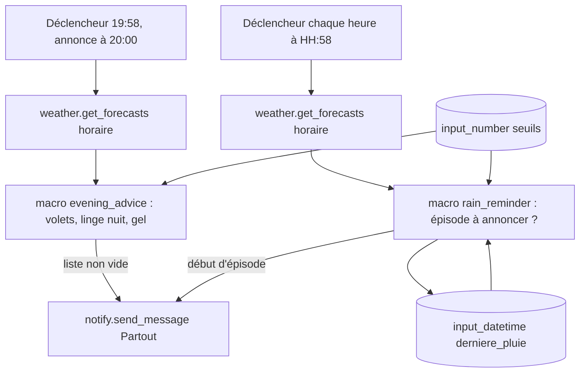

# Consignes météo vocales - Plan

## Goal Capsule

- **Objective :** le linge n'est plus mouillé par une pluie prévue, les volets sont fermés avant une journée chaude et le robinet extérieur est protégé avant une nuit de gel. La maison le rappelle à voix haute au bon moment, et elle se tait quand rien ne l'exige.
- **Product authority :** Etienne. Les seuils et le texte des annonces se règlent à l'usage (R9, R10).
- **Means :** un package YAML et un template Jinja testable, qui lisent la prévision Met.no et annoncent sur « Partout » (KTD1, KTD2).
- **Open blockers :** aucun. `notify.partout_annoncer` n'a jamais servi et s'éprouve en premier (U1).
- **Execution profile :** `ce-work` en autonomie, déploiement sur le Pi par `./scripts/deploy.sh`, push direct sur `main` autorisé pour ce dépôt.
- **Stop conditions :** arrêter et demander si `weather.get_forecasts` ne renvoie plus `precipitation` ou `temperature` horaires, ou si aucune entité `notify.*_annoncer` ne parle.
- **Product Contract preservation :** Product Contract unchanged ; les deux questions « Deferred to Planning » sont tranchées par KTD4 et KTD5.

---

## Product Contract

### Summary

Chaque soir à 20 h, une annonce vocale unique sur tous les Echo regroupe les consignes du lendemain et de la nuit : fermer les volets, rentrer le linge, protéger le robinet. En journée, un rappel part 2 h avant la pluie prévue. Tout s'appuie sur la prévision Met.no déjà présente sur le Pi.

### Problem Frame

Aujourd'hui rien n'anticipe la météo à la maison. Le seul geste existant est de rentrer le linge quand la pluie est déjà là, souvent trop tard. Les journées de canicule, la maison chauffe parce que les volets n'ont pas été fermés la veille. Le gel est rare, mais un robinet extérieur qui éclate coûte une réparation. Ces trois oublis ont un point commun : l'information existe la veille ou quelques heures avant, mais personne ne la consulte au moment où elle servirait.

### Key Decisions

- **Deux rendez-vous, pas une consigne unique la veille au soir.** Le linge se joue dans la journée, alors que les volets et le gel se décident le soir. Governs R1, R5. (session-settled: user-directed — chosen over une annonce unique le matin ou la veille au soir : chaque consigne a son moment utile.)
- **Annonce sur « Partout » par défaut, appareil réglable.** Tous les Echo parlent par défaut ; le choix d'un seul Echo ou du téléphone se fait depuis le tableau de bord, sans redéploiement. Governs R2. (session-settled: user-directed — chosen over un appareil fixé dans la configuration : choix demandé pendant l'implémentation.)
- **Met.no seul, pas d'intégration Météo-France.** La prévision horaire de pluie, le maximum du lendemain et le minimum de la nuit suffisent aux trois consignes. La vigilance Météo-France ne servait qu'au vent et à l'orage, qui sortent du périmètre. (session-settled: user-approved — chosen over l'ajout de l'intégration core Météo-France : pas de consigne vent retenue.)
- **Volets jugés sur le maximum extérieur prévu, sans comparaison avec l'intérieur.** Un seuil unique est lisible et réglable. Governs R3. (session-settled: user-directed — 28 °C retenu plutôt que 30 °C proposé.)
- **Home Assistant ne sait pas si du linge est dehors.** Le rappel pluie part donc même sans linge étendu, limité à un par épisode de pluie pour contenir le bruit. Governs R6, R7.

### Requirements

**Annonce du soir**

- R1. Chaque jour à 20 h, une seule annonce regroupe toutes les consignes qui s'appliquent ; aucune annonce si aucune ne s'applique.
- R2. Les annonces passent par l'appareil choisi dans le tableau de bord : le groupe d'Echo « Partout » par défaut, un Echo ou le téléphone.
- R3. Consigne volets : quand le maximum prévu pour le lendemain atteint ou dépasse le seuil chaleur (28 °C au départ).
- R4. Consigne linge du soir : quand une heure de 20 h à 7 h inclus le lendemain prévoit au moins le seuil pluie (0,5 mm au départ).
- R5. Consigne robinet : quand le minimum prévu entre 20 h et 8 h le lendemain descend au seuil gel ou en dessous (1 °C au départ).

**Rappel pluie de la journée**

- R6. Pour un épisode de pluie qui commence entre 8 h et 19 h inclus, un rappel « rentrer le linge » part 2 h avant sa première heure de pluie (au moins le seuil pluie).
- R7. Un épisode commence à une heure de pluie précédée d'au moins 3 heures sèches ; il ne donne qu'un rappel.
- R8. Si la pluie d'un épisode commence avant 10 h, le rappel part à 8 h.

**Réglages**

- R9. Les seuils chaleur, gel et pluie se règlent depuis le tableau de bord, sans redéploiement.
- R10. Le texte des annonces est court, en français, une phrase par consigne ; il s'ajuste à l'usage.

### Acceptance Examples

- AE1. **Covers R1, R3, R5.** Given demain 29 °C au maximum et une nuit à 12 °C au minimum, when il est 20 h, then une seule annonce : fermer les volets.
- AE2. **Covers R1.** Given demain 22 °C, une nuit sèche à 8 °C, when il est 20 h, then aucune annonce.
- AE3. **Covers R1, R4, R5.** Given 2 mm prévus à 3 h et un minimum de 0 °C à 6 h, when il est 20 h, then une annonce avec deux consignes : rentrer le linge, protéger le robinet.
- AE4. **Covers R6, R7.** Given une pluie prévue de 15 h à 18 h après une matinée sèche, when il est 13 h, then un rappel ; aucun autre rappel à 16 h ou 17 h.
- AE5. **Covers R7.** Given de la pluie à 11 h puis de nouveau à 16 h, avec 4 heures sèches entre les deux, when la journée passe, then deux rappels, à 9 h et à 14 h.
- AE6. **Covers R8.** Given une pluie prévue à 9 h, when il est 8 h, then le rappel part à 8 h.
- AE7. **Covers R6.** Given une pluie prévue à 21 h, when la journée passe, then aucun rappel de journée ; la pluie est couverte par l'annonce de 20 h (R4).

### Scope Boundaries

- Vent, orage et rentrer le parasol ou les coussins.
- Intégration Météo-France et ses vigilances.
- Conseil d'ouverture des fenêtres le soir quand il fait plus frais dehors que dedans.
- Notification sur le téléphone, et rattrapage quand personne n'est à la maison.
- Lien avec la fin de cycle du lave-linge (idée 1 de l'idéation) pour ne prévenir que s'il y a du linge à étendre. C'est l'évolution naturelle, mais la détection de cycle n'existe pas encore.

### Dependencies / Assumptions

- `notify.partout_annoncer` existe sur le Pi mais n'a jamais servi (état `unknown`). S'il n'annonce pas sur tous les Echo, l'annonce part sur chacun des quatre Echo, ce qui donne le même résultat pour l'utilisateur.
- `weather.forecast_maison` (intégration `met`) fournit une prévision horaire sur 48 h avec `precipitation` en mm et `temperature`, et une prévision journalière avec `temperature` et `templow`. Elle ne fournit pas de probabilité de pluie.
- La température Met.no est une prévision à 2 m ; le seuil gel à 1 °C garde une marge pour un robinet exposé.

### Outstanding Questions

**Deferred to Planning**

- Fréquence de relecture de la prévision en journée : tranchée par KTD4.
- Ce que fait un rappel déjà émis quand la prévision recule l'épisode de plusieurs heures : tranché par KTD5.

### Sources / Research

- Idée 7 de `docs/ideation/2026-10-23-home-assistant-hors-electricite-ideation.html`, dont ce plan resserre le périmètre.
- `config/packages/notifications.yaml` pour les conventions de notification existantes.
- `docs/solutions/echo-piloter-depuis-ha.md` pour le pilotage des Echo et le groupe « Partout ».

---

## Planning Contract

### Key Technical Decisions

- KTD1. **La décision vit dans un template Jinja pur, les automatisations ne font que lire la prévision et annoncer.** `config/custom_templates/weather_advice.jinja` reçoit la prévision, l'heure courante, les seuils et l'état mémorisé, et rend un JSON (les macros HA rendent du texte, le consommateur fait `| from_json`). C'est ce qui rend R1 à R8 testables sur le Pi via `POST /api/template` avec des prévisions fabriquées, sans attendre la météo réelle. Le dépôt n'a aucune suite de tests aujourd'hui.
- KTD2. **Annonce par un script commun qui envoie `notify.send_message` à l'entité correspondant à `input_select.meteo_appareil`.** U1 a confirmé que `notify.partout_annoncer` parle sur les quatre Echo ; le téléphone passe par `notify.pixel_6`. Applies R2.
- KTD3. **Seuils en `input_number` sans `initial`.** Un `initial` réécrirait la valeur à chaque redémarrage et casserait R9. Sans lui, HA restaure la dernière valeur, mais crée l'entité à son `min` : les valeurs de départ (28, 1, 0,5) se posent une fois par `input_number.set_value` après le premier redémarrage.
- KTD4. **Le rappel pluie lit la prévision chaque heure à HH:58, jour et nuit, pour l'heure H qui commence, et annonce à H:00.** Lue dans l'heure, la prévision commence à l'heure suivante (KTD6) : la lire deux minutes avant H garantit que H y figure. La lecture de nuit ne sert qu'à mémoriser la pluie, sans annoncer ; les annonces ne partent que pour H entre 8 h et 17 h (R6, R8). Sans elle, une pluie qui s'arrête à 6 h serait invisible et la pluie de 9 h passerait pour un nouvel épisode (R7).
- KTD5. **Un seul `input_datetime`, `meteo_derniere_pluie`, mémorise la dernière heure de pluie déjà commencée.** À chaque lecture, la macro évalue d'abord l'épisode, puis rend comme nouvelle mémoire H si l'heure H est pluvieuse, sinon la mémoire inchangée ; jamais une heure postérieure à H. Un début R est nouveau si la mémoire est antérieure à R moins 3 heures et si les heures prévues de H à R moins 1 sont sèches (R7). Le rappel ne vise que R = H + 2, ou à 8 h le premier début entre 8 h et 10 h (R8) : chaque début n'est évalué qu'une fois, sans mémoire des rappels envoyés.
- KTD6. **Les heures se comparent en heure locale, jamais par position dans la liste.** `weather.get_forecasts` horaire renvoie des datetimes UTC (`2026-10-30T09:00:00+00:00`) et sa première entrée est l'heure UTC à venir, pas forcément l'heure courante. Le template convertit chaque entrée par `as_datetime | as_local` avant de filtrer les plages horaires de R4, R5 et R6.
- KTD7. **Volets sur le maximum horaire du lendemain plutôt que sur `temperature` journalière.** La prévision horaire couvre 48 h, donc tout le lendemain à 20 h ; elle évite de dépendre de l'heure d'ancrage des entrées journalières Met.no, non vérifiée. Applies R3.
- KTD8. **L'annonce du soir lit la prévision à 19:58 et parle à 20:00.** Lue à 20:00 ou après, la prévision peut ne plus contenir l'heure de 20 h (KTD6), et une pluie qui commence à 20 h échapperait à la fois à R4 et à R6. Applies R1, R4.

### High-Level Technical Design

### Assumptions

- `notify.send_message` accepte plusieurs entités cibles, ce qui suffit au repli de KTD2.
- Le seuil pluie s'applique à chaque heure : une heure « de pluie » est une heure prévue à au moins `input_number.meteo_seuil_pluie` mm.

---

## Implementation Units

### U1. Éprouver l'annonce « Partout »

- **Goal :** savoir si `notify.partout_annoncer` parle sur les quatre Echo avant de bâtir dessus.
- **Requirements :** R2, KTD2.
- **Dependencies :** aucune.
- **Files :** aucun.
- **Approach :** appeler `notify.send_message` sur `notify.partout_annoncer` avec une phrase courte, à une heure où quelqu'un est à la maison, et faire constater l'annonce dans chaque pièce ; à défaut, rejouer sur les quatre entités `*_annoncer`.
- **Test expectation :** none -- sonde d'exécution, son résultat fixe la cible de KTD2.
- **Verification :** la cible retenue est notée dans le commit de U3, et Etienne a entendu l'annonce dans chaque pièce.

### U2. Seuils, mémoire et réglages

- **Goal :** créer les trois seuils et la mémoire de pluie, et rendre les seuils réglables depuis le tableau de bord.
- **Requirements :** R9, KTD3, KTD5.
- **Dependencies :** aucune.
- **Files :**
  - `config/packages/weather_advice.yaml` (nouveau)
  - `config/dashboards/maison.yaml`
- **Approach :**
  1. Dans le package : `input_number.meteo_seuil_chaleur` (°C, pas de 1), `input_number.meteo_seuil_gel` (°C, pas de 0,5), `input_number.meteo_seuil_pluie` (mm, pas de 0,1), sans `initial` (KTD3) ; `input_datetime.meteo_derniere_pluie`, date et heure (KTD5).
  2. Dans l'onglet Températures, une section « Consignes météo » avec les trois seuils en tuiles réglables.
  3. Déployer, redémarrer HA (nouveau package), poser 28, 1 et 0,5.
- **Patterns to follow :** `config/packages/music.yaml` pour les helpers déclarés en YAML ; les sections de l'onglet Températures de `config/dashboards/maison.yaml`.
- **Test expectation :** none -- helpers et tableau de bord sans logique.
- **Verification :** les quatre entités existent sur le Pi, les seuils valent 28, 1 et 0,5 et gardent leur valeur après un redémarrage.

### U3. Décision du soir et automatisation de 20 h

- **Goal :** annoncer à 20 h les consignes volets, linge de nuit et gel qui s'appliquent, et rien sinon.
- **Requirements :** R1, R2, R3, R4, R5, R10, KTD1, KTD6, KTD7, KTD8 ; AE1, AE2, AE3.
- **Dependencies :** U1, U2.
- **Files :**
  - `config/custom_templates/weather_advice.jinja` (nouveau)
  - `config/packages/weather_advice.yaml`
  - `scripts/test-weather-advice.mjs` (nouveau)
- **Approach :**
  1. Macro `evening_advice` : à partir de la prévision horaire et de l'heure courante, maximum du lendemain (KTD7), heures de 20 h à 7 h pour la pluie (R4) et de 20 h à 8 h pour le minimum (R5), en heure locale (KTD6) ; rend la liste ordonnée des consignes avec la valeur utile à la phrase.
  2. Automatisation `weather_advice_evening` : déclencheur à 19:58, lecture `weather.get_forecasts` horaire sur `weather.forecast_maison`, appel de la macro, attente de 20:00 (KTD8), une seule annonce qui enchaîne les phrases, aucune action si la liste est vide.
  3. Textes de départ, réglables à l'usage (R10) : « Demain il fera N degrés, ferme les volets ce soir. », « Il va pleuvoir cette nuit, rentre le linge. », « Gel prévu cette nuit, protège le robinet extérieur. ».
  4. Script de test : envoie à `POST /api/template` un import de la macro avec une prévision fabriquée et compare le JSON rendu à l'attendu ; lit `HA_URL` et `HA_TOKEN` comme `scripts/import-battery-history.mjs`.
- **Patterns to follow :** `config/custom_templates/mylight.example.jinja` pour l'import d'un template personnalisé ; automatisations de `config/packages/notifications.yaml` pour la forme (id, alias, `mode`) ; `scripts/import-battery-history.mjs` pour le script Node.
- **Test scenarios :**
  - Covers AE1. Lendemain à 29 °C au maximum, nuit à 12 °C au minimum, aucune pluie : la macro rend la seule consigne volets, avec 29.
  - Covers AE2. Lendemain à 22 °C, nuit sèche à 8 °C : la macro rend une liste vide.
  - Covers AE3. 2 mm à 3 h et 0 °C à 6 h : la macro rend linge puis robinet.
  - Seuil exact : lendemain à 28 °C pile, consigne volets présente ; nuit à 1 °C pile, consigne gel présente ; 0,5 mm pile, consigne linge présente.
  - Bornes horaires de la pluie : 2 mm à 19 h ou à 8 h n'entrent pas dans la consigne linge du soir ; 2 mm à 20 h et à 7 h y entrent.
  - Borne du gel : 0 °C à 8 h donne la consigne robinet ; 0 °C à 9 h ne la donne pas.
  - Heure de 20 h présente : une prévision lue à 19:58 dont la première entrée est 20 h et porte 2 mm donne la consigne linge.
  - Fuseau : une prévision en UTC dont 19:00Z vaut 20 h locale est comptée dans la nuit.
- **Verification :** le script de test passe ; après un passage temporaire du seuil chaleur à 10 °C, un déclenchement manuel de l'automatisation fait parler tous les Echo, puis le seuil revient à 28.

### U4. Rappel pluie de la journée

- **Goal :** annoncer un rappel « rentrer le linge » 2 h avant chaque épisode de pluie diurne, une seule fois par épisode.
- **Requirements :** R6, R7, R8, R2, R10, KTD1, KTD4, KTD5, KTD6 ; AE4, AE5, AE6, AE7.
- **Dependencies :** U3 (template et script de test existent).
- **Files :**
  - `config/custom_templates/weather_advice.jinja`
  - `config/packages/weather_advice.yaml`
  - `scripts/test-weather-advice.mjs`
- **Approach :**
  1. Macro `rain_reminder` : à partir de la prévision horaire, de l'heure H qui commence, du seuil pluie et de la mémoire, rend la nouvelle mémoire et, s'il y a lieu, le début d'épisode à annoncer (règles R6 à R8, KTD5).
  2. Automatisation `weather_advice_rain` : déclencheur chaque heure à HH:58, `mode: single` ; met à jour `input_datetime.meteo_derniere_pluie` avec la mémoire rendue à chaque passage ; attend H:00 et annonce seulement pour H entre 8 h et 17 h et quand la macro rend un début (KTD4).
  3. Texte de départ : « Pluie prévue vers N heures, rentre le linge. »
- **Test scenarios :**
  - Covers AE4. Pluie de 15 h à 18 h après une matinée sèche : pour H = 13 h la macro rend 15 h ; pour H = 14 h, 15 h et 16 h elle ne rend rien et, à partir de H = 15 h, rend 15 h, 16 h, 17 h, 18 h comme mémoire.
  - Covers AE5. Pluie à 11 h puis à 16 h, 4 heures sèches entre : à 9 h elle rend 11 h, à 14 h elle rend 16 h.
  - Covers AE6. Pluie à 9 h : à 8 h la macro rend 9 h.
  - Covers AE7. Pluie à 21 h : aucune heure entre 8 h et 17 h ne rend de début.
  - Pluie qui s'arrête à 6 h puis reprend à 9 h, dernière pluie mémorisée à 6 h : à 8 h la macro ne rend rien, faute de 3 heures sèches.
  - Mémoire jamais en avance : pour H = 7 h avec 7 h sec et 8 h pluvieux, la mémoire ne bouge pas ; pour H = 8 h la macro rend 8 h comme début (R8) puis 8 h comme mémoire.
  - Mémoire de l'heure courante : pour H = 3 h avec 3 h pluvieux, la mémoire devient 3 h.
  - Bruine à 0,3 mm avec seuil à 0,5 : aucune heure de pluie, aucun rappel.
- **Verification :** le script de test passe ; la trace de l'automatisation sur le Pi montre une exécution à chaque HH:58 et, une heure pluvieuse, la mise à jour de `input_datetime.meteo_derniere_pluie`.

### U5. Documentation

- **Goal :** que le README décrive le nouveau package, le template et le script de test.
- **Requirements :** R9, R10 (où régler les seuils et les textes).
- **Dependencies :** U3, U4.
- **Files :** `README.md`.
- **Approach :** trois lignes dans la table « Contenu » ; dans « Déployer », la commande du script de test et le rechargement des templates personnalisés qu'il demande.
- **Test expectation :** none -- documentation.
- **Verification :** chaque fichier ajouté a sa ligne dans la table « Contenu ».

---

## Scope Boundaries (plan)

- Alerte si `weather.get_forecasts` échoue pour le rappel pluie de la journée : non construite, une panne n'y coûte qu'un rappel. L'annonce du soir, elle, dit « Prévisions météo indisponibles, consignes non vérifiées ce soir. » (choix d'Etienne pendant l'implémentation).
- Suppression d'un second rappel quand la prévision recule un épisode déjà annoncé : envisagée, non construite. Le pire cas est un « rentre le linge » de plus, entendu tout de suite ; à revoir si des doublons gênent à l'usage.
- Modifications des autres packages, dont `notifications.yaml` et son `notify.mobile_app_pixel_6` : hors périmètre.

---

## Verification Contract

| Quand | Commande ou geste | Preuve attendue |
|---|---|---|
| Chaque unité qui touche `config/` | `./scripts/deploy.sh` | sortie 0, `ha core check` passé |
| Après U2 (nouveau package) | `ssh ha 'ha core restart'` | entités `input_number.meteo_*` et `input_datetime.meteo_*` présentes |
| Après chaque modification du template | `homeassistant.reload_custom_templates` puis `HA_URL=http://192.168.1.250 HA_TOKEN=… node scripts/test-weather-advice.mjs` | tous les cas passent, sortie 0 |
| Fin de U3 | seuil chaleur à 10 °C, `automation.trigger` sur `weather_advice_evening`, seuil remis à 28 | annonce entendue dans chaque pièce |

Le jeton se lit dans le trousseau (`security find-generic-password -s ha-nyons -w`) et ne s'affiche jamais.

---

## Definition of Done

- U1 à U5 vérifiées selon leur champ Verification.
- Le script de test couvre AE1 à AE7 et passe sur le Pi.
- Les seuils valent 28, 1 et 0,5 sur le Pi après le dernier redémarrage, et aucune valeur forcée pour un test n'est restée.
- Aucun code d'essai abandonné dans le diff.
